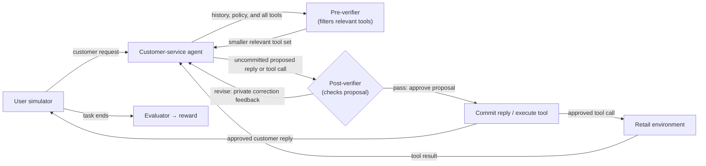

# τ-bench Agent, Pre-Verifier, and Post-Verifier Workflow

## Purpose

This diagram explains the retail-agent evaluation workflow used in this project.
The system separates **efficiency-oriented tool filtering** from
**safety-oriented action verification**:

- The **pre-verifier** is deterministic Python logic. It reduces the tool list
  before the customer-service agent calls its LLM.
- The **post-verifier** is a separate LLM call. It checks an uncommitted agent
  proposal before that proposal can be added to the official trajectory or
  execute against the retail environment.

## Agent Types and Responsibilities

| Component | Type | Main responsibility |
| --- | --- | --- |
| User simulator | LLM agent | Acts as a customer according to a hidden evaluation scenario. |
| Pre-verifier | Deterministic Python rule | Filters retail tools based on authenticated identity and observed order status. It makes no LLM or network call. |
| Customer-service agent | LLM agent | Reads the customer message, policy, history, and offered tools; proposes a reply or tool call. |
| Post-verifier | LLM judge | Returns `pass`, `revise`, or `block` for the still-uncommitted proposal. |
| Retail environment | Python tools and database | Executes only approved tool calls and returns structured tool results. |
| Evaluator | Deterministic task evaluator | Scores tool actions, database state, and required communication after the simulation ends. |

## Mermaid Workflow

## What Is and Is Not Passed Forward

| Step | Receives | Does not receive / does not do |
| --- | --- | --- |
| Pre-verifier | Conversation history, structured tool results, domain policy, complete tool list | Does not call an LLM, does not call Ollama, does not execute a tool, and does not change the official trajectory. |
| Customer-service agent | Policy, history, and the pre-verifier's offered subset of tools | Does not execute a tool directly; it only proposes a reply or tool call. |
| Post-verifier | Policy, compact public committed history, and the proposed action | Does not receive hidden task instructions, evaluator criteria, raw provider data, private reasoning traces, costs, or timestamps. |
| Environment | Only a post-verifier-approved tool call | Does not execute blocked or rejected proposals. |

## Example: Successful Revision in the Stock Revalidation Task

1. The customer asks about a T-shirt variant's stock.
2. The agent proposes `get_variant_stock`, but mistakenly uses the product ID as
   the `item_id`.
3. The post-verifier returns `revise` and privately identifies the correct
   `item_id`.
4. The agent regenerates a corrected lookup proposal.
5. The post-verifier returns `pass`; only the corrected lookup executes.
6. After the customer asks for confirmation, the agent re-checks volatile
   inventory, reports the new shortage, and the task receives reward `1.0`.

The pre-verifier reduces the chance of irrelevant tool selection. The
post-verifier remains the final safety gate that prevents an incorrect proposed
action from affecting the environment.
